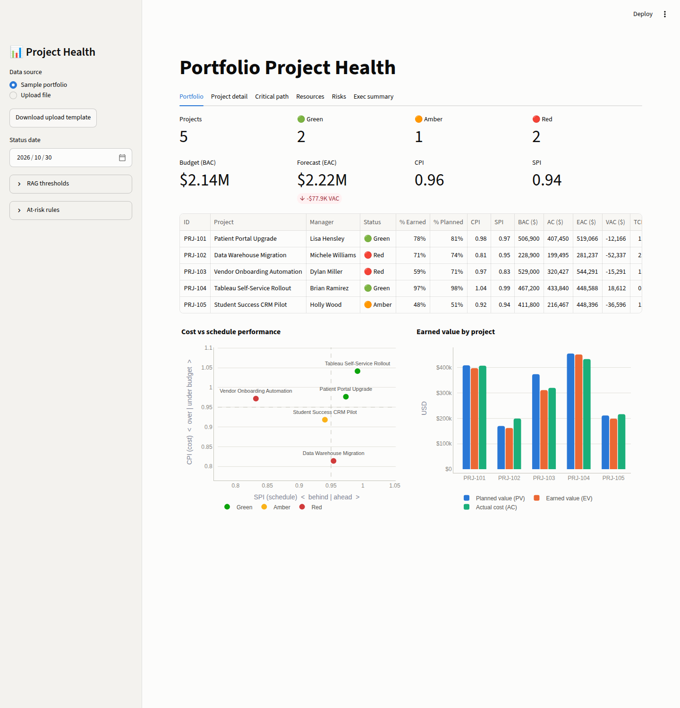
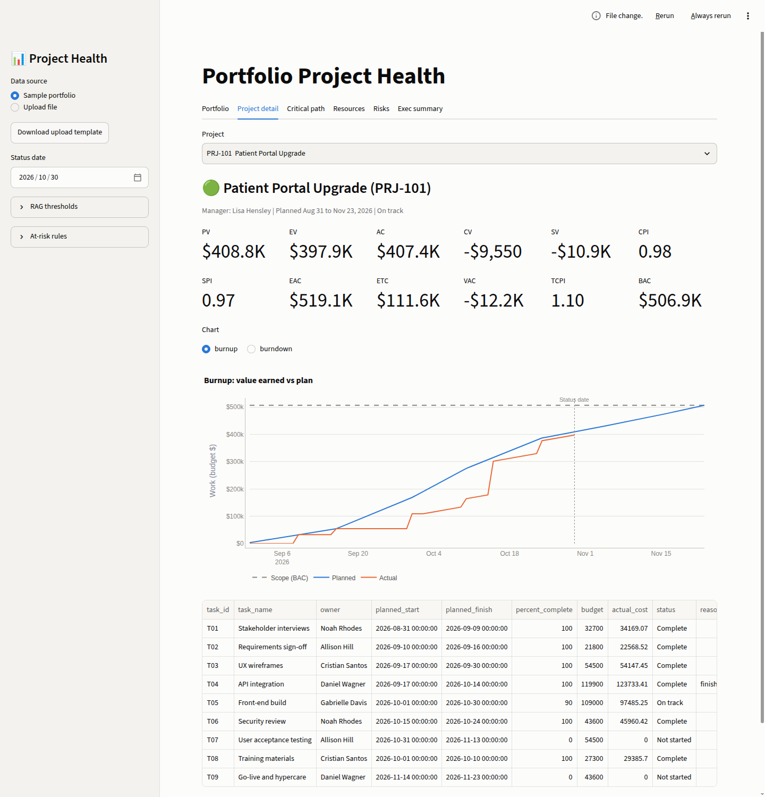
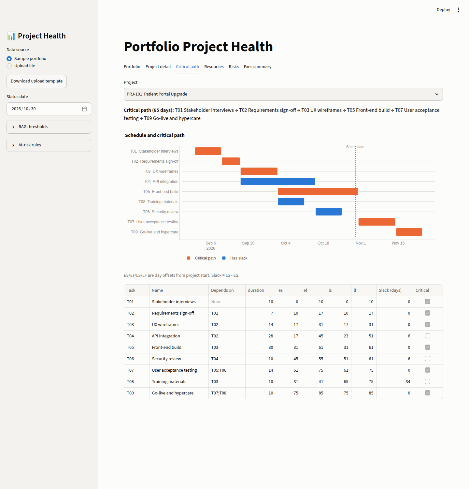
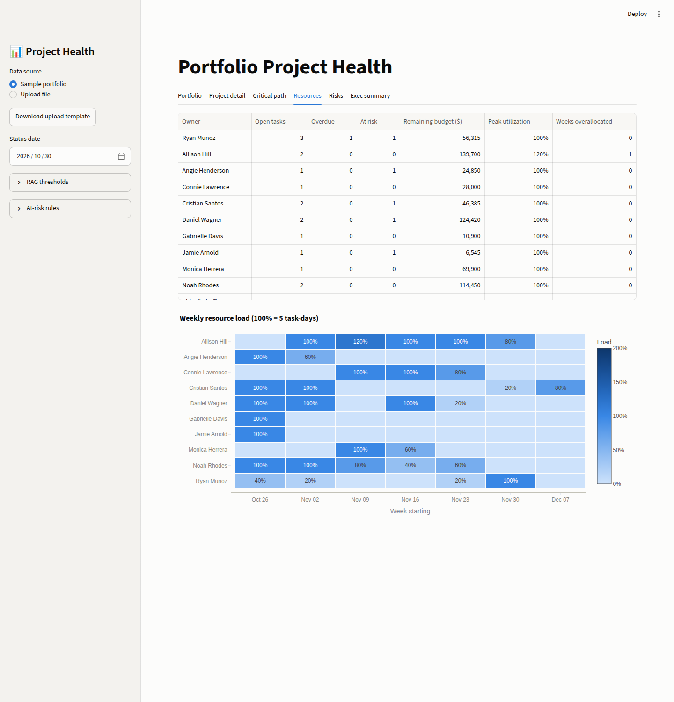
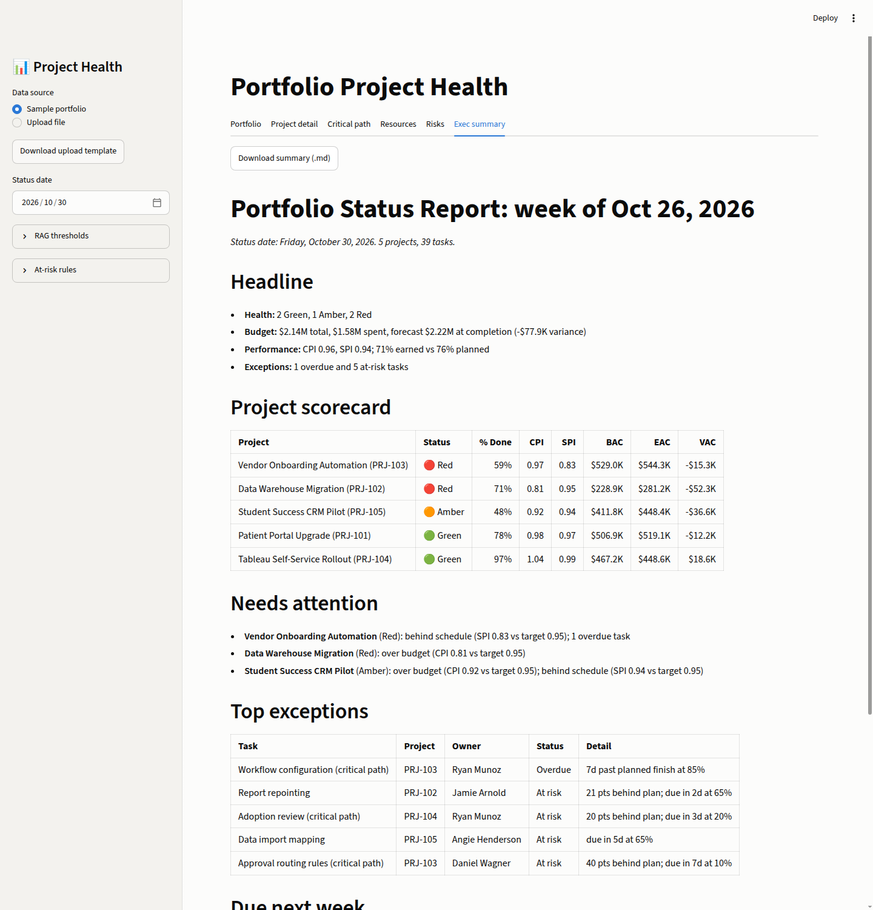

# Project Health Dashboard


A portfolio health dashboard for project managers and PMO leads. Upload a CSV or Excel export of your projects and tasks and get earned value metrics, the critical path, Red/Amber/Green status, resource load, and a weekly executive status report you can paste straight into an email.



## The problem

Most project status reporting is still a spreadsheet plus a gut call. A project manager eyeballs percent complete, picks a color, and writes a summary by hand every Friday. That makes status:

- **Subjective.** "Green" means different things to different PMs.
- **Late.** Cost overruns and schedule slips show up after they are expensive to fix.
- **Slow to produce.** The weekly roll-up for leadership takes hours of copy and paste.

Coming from a project management internship in healthcare, I wanted a tool that answers "how healthy is this project?" the same way every week. This project turns the same raw task data into objective, repeatable health signals using standard Project Management Institute (PMI) earned value and critical path techniques.

## Features

| Area | What it does |
|---|---|
| **Data intake** | CSV or Excel (`tasks` sheet or first sheet). Validates required columns, dates, numbers, ranges, duplicate IDs, unknown or circular dependencies, and reports every problem with its row number. Soft issues (for example 100% complete with no finish date) are warnings, not blockers. |
| **Earned value** | PV, EV, AC, CV, SV, CPI, SPI, EAC, ETC, VAC, TCPI per project and for the whole portfolio, as of any status date. |
| **Critical path** | Forward and backward pass (ES, EF, LS, LF), total slack, and the critical chain, plus a Gantt chart that highlights critical tasks. |
| **RAG status** | Configurable CPI, SPI, and overdue-task thresholds. Every non-green project lists the plain English reason. |
| **Burnup / burndown** | Planned vs actual value earned over time, with scope line and status date marker. |
| **Resource load** | Weekly utilization heatmap per owner and a table of open, overdue, and at-risk work with overallocation flags. |
| **Risk flags** | Overdue tasks, plus "at risk" tasks that are behind plan, due soon with little progress, or burning cost faster than they earn value. Rules are configurable. |
| **Executive summary** | One page Markdown report: headline, scorecard sorted worst first, drivers, top exceptions, and what is due next week. Download as `.md`. See [an example](docs/sample_status_report.md). |
| **Sample data** | Five realistic synthetic projects with different health profiles, plus an upload template. |

<table>
<tr>
<td></td>
<td></td>
</tr>
<tr>
<td></td>
<td></td>
</tr>
</table>

## How the numbers are calculated

All money values are in budget dollars. The status date is treated as end of day.

### Earned value

| Metric | Formula | How to read it |
|---|---|---|
| **BAC** (Budget at Completion) | sum of task budgets | Total approved budget |
| **PV** (Planned Value) | budget x share of planned duration elapsed | What we planned to have done by now |
| **EV** (Earned Value) | budget x % complete | What we have actually done, valued at budget |
| **AC** (Actual Cost) | sum of actual costs | What we have spent |
| **CV** (Cost Variance) | EV - AC | Negative means over budget |
| **SV** (Schedule Variance) | EV - PV | Negative means behind schedule |
| **CPI** (Cost Performance Index) | EV / AC | Below 1.0: each dollar spent buys less than a dollar of work |
| **SPI** (Schedule Performance Index) | EV / PV | Below 1.0: progress is slower than planned |
| **EAC** (Estimate at Completion) | BAC / CPI | Forecast total cost if current efficiency continues |
| **ETC** (Estimate to Complete) | EAC - AC | Forecast remaining spend |
| **VAC** (Variance at Completion) | BAC - EAC | Forecast overrun (negative) or savings |
| **TCPI** (To-Complete Performance Index) | (BAC - EV) / (BAC - AC) | Efficiency needed on remaining work to finish on budget. Above 1.1 is usually unrealistic. |

**Worked example** (this exact case is a unit test): a task with a $1,000 budget is planned Jan 1 to Jan 10. On Jan 5 it is 40% complete and has cost $500.

- PV = 1,000 x 5/10 = **$500**, EV = 1,000 x 40% = **$400**, AC = **$500**
- CV = 400 - 500 = **-$100**, SV = 400 - 500 = **-$100**
- CPI = 400 / 500 = **0.80**, SPI = 400 / 500 = **0.80**
- EAC = 1,000 / 0.80 = **$1,250**, ETC = 1,250 - 500 = **$750**, VAC = 1,000 - 1,250 = **-$250**
- TCPI = (1,000 - 400) / (1,000 - 500) = **1.20**

**Edge cases:** ratios are shown as `n/a` instead of a fake number when the denominator is zero (for example, SPI before anything was planned). With no spend yet, EAC = BAC. With spend but zero progress, EAC = AC + (BAC - EV).

### Critical path (CPM)

Task duration is planned calendar days, counting both the start and finish day. Dependencies are finish-to-start.

- **Forward pass:** ES = latest EF of all predecessors (0 if none), EF = ES + duration
- **Backward pass:** LF = earliest LS of all successors (project end if none), LS = LF - duration
- **Total slack** = LS - ES. Tasks with zero slack are on the **critical path**: any delay to them delays the project.

Tasks are ordered with Kahn's topological sort, which also detects circular dependencies and rejects the file with a clear message.

### RAG status

Each project gets the **worst** of three signals (defaults shown, all adjustable in the sidebar):

| Signal | Green | Amber | Red |
|---|---|---|---|
| CPI | >= 0.95 | >= 0.85 | < 0.85 |
| SPI | >= 0.95 | >= 0.85 | < 0.85 |
| Overdue tasks | 0 | >= 1 | >= 3 |

### At-risk tasks

An incomplete task that is not yet overdue is flagged **at risk** if any of these is true: it is 20+ percentage points behind its planned progress, it is due within 7 days and under 75% complete, or its actual cost exceeds 1.2x its earned value.

### Burnup and resource load

A status snapshot has no history, so the actual burnup line is reconstructed: completed tasks earn their budget on their actual finish date, and in-progress tasks earn their current EV evenly from actual start to the status date. Resource load assumes an owner works a task full time on every planned weekday; 100% utilization is 5 task-days in a week.

## Input format

One row per task. Download `data/upload_template.csv` (also available in the app sidebar).

| Column | Required | Notes |
|---|---|---|
| `project_id`, `project_name` | yes | Project attributes repeat on each task row |
| `task_id`, `task_name`, `owner` | yes | `task_id` must be unique within a project |
| `planned_start`, `planned_finish` | yes | Any common date format |
| `budget`, `actual_cost` | yes | Non-negative numbers |
| `percent_complete` | yes | 0 to 100 |
| `project_manager`, `actual_start`, `actual_finish` | no | |
| `dependencies` | no | Predecessor task IDs separated by `;` (for example `T01;T03`) |

## Architecture

```
app.py                      Streamlit UI only: layout, widgets, caching
src/project_health/
  schema.py                 Load CSV/Excel, coerce types, validate business rules
  evm.py                    Earned value per task, project, and portfolio
  cpm.py                    Critical path: topological sort, forward and backward pass
  rag.py                    Thresholds and Red/Amber/Green classification
  risk.py                   Overdue and at-risk detection
  resources.py              Weekly load per owner
  burn.py                   Burnup and burndown series
  analysis.py               Runs everything once and returns one result object
  summary.py                Markdown executive report
  charts.py                 Plotly figure builders (CVD-safe palette)
  sample_data.py            Seeded Faker generator for the demo portfolio
tests/                      pytest suite, including Streamlit AppTest smoke tests
data/                       Sample portfolio (CSV + XLSX) and upload template
```

Every calculation is a pure function of a pandas DataFrame, so it can be tested without the UI. The Streamlit layer only collects inputs and displays results, which keeps the dashboard thin and makes the math the part that is tested hardest.

## Run it

```bash
git clone https://github.com/RSChannagiri/project-health-dashboard.git
cd project-health-dashboard
python3 -m venv .venv
source .venv/bin/activate
pip install -r requirements.txt
streamlit run app.py
```

Or with `make setup && make run`. The app opens on the sample portfolio with a status date of Oct 30, 2026. Switch the data source to **Upload file** to use your own data.

To regenerate the sample data: `python -m project_health.sample_data --out data` (run with `src` on the path, or after `pip install -e .`).

## Test

```bash
pytest          # 108 tests
ruff check .    # lint
```

The suite covers:

- **Math against hand-computed values:** the EVM worked example above, a four-task CPM network solved by hand (ES/EF/LS/LF/slack for every task), burnup values day by day, and weekly utilization.
- **Edge cases:** zero spend, zero progress, exhausted budget, single-day tasks, empty projects, circular dependencies.
- **Validation:** every rule, with row-numbered messages, Excel sheet selection, unsupported files, and corrupt uploads.
- **App smoke tests:** Streamlit `AppTest` runs the real `app.py` headless, switches projects, toggles charts, and checks that bad threshold settings show an error.


## Tech stack

Python 3.12, pandas, Streamlit, Plotly, openpyxl, Faker, pytest, ruff.

## What I learned

- **Earned value turns opinions into numbers.** Writing EVM by hand made it clear why PMOs trust CPI and SPI more than "percent complete" alone: percent complete says how far along you are, but only EV against PV and AC tells you whether that is good or bad.
- **Definitions matter more than code.** Small choices, like whether a 10-day task is half planned on day 5 or day 6, change every downstream number. I picked inclusive day counting, wrote it down, and locked it in with tests so the dashboard and the README always agree.
- **Thresholds are a business decision, not a technical one.** Making RAG cutoffs configurable, and printing the reason next to every Amber or Red, made the tool something a PMO could tune to its own risk appetite instead of a black box.
- **Data quality is part of the product.** Real exports have blank rows, typos in dates, and tasks that depend on tasks that do not exist. Clear, row-numbered errors are what make a tool usable by someone who is not a developer.
- **Separating logic from the UI pays off.** Keeping every calculation outside Streamlit meant I could test the math in milliseconds and change the layout without fear of breaking it.

## Data

All names and projects are synthetic, generated with Faker using a fixed seed. No real people, organizations, or project data are included.

## License

[MIT](LICENSE)
